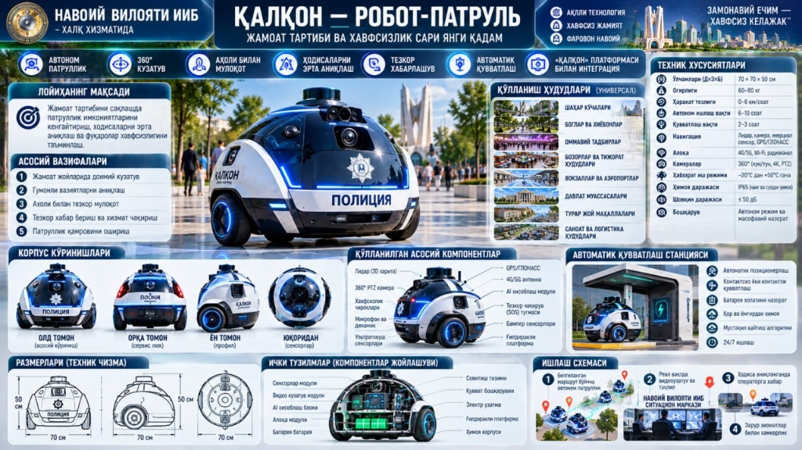
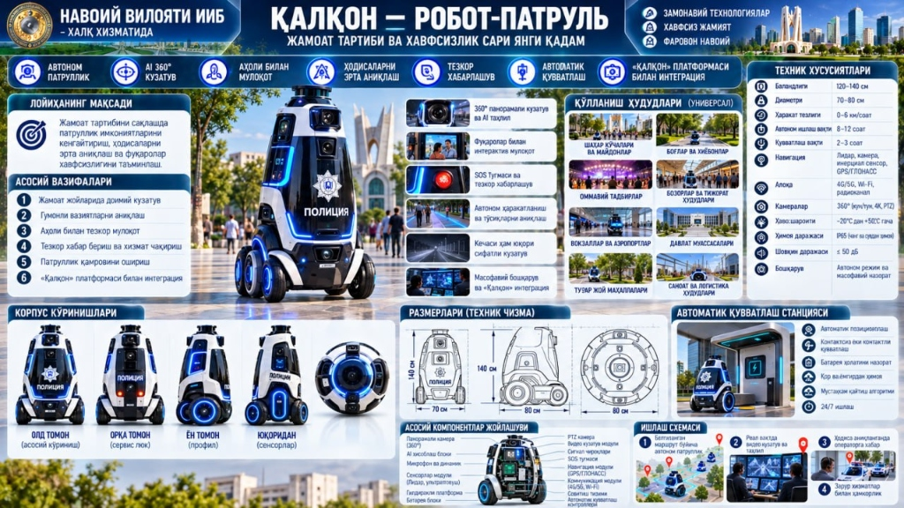

# 🛡️ «QALQON — ROBOT-PATRUL» (Navoiy viloyati IIB & NDKTU)

**Jamoat tartibini saqlash va patrullik faoliyatini takomillashtirishga mo'ljallangan avtonom ko'chma robot-stansiya**

- **Buyurtmachi:** Navoiy viloyati Ichki ishlar boshqarmasi (IIB)
- **Bajaruvchi:** Navoiy Davlat Konchilik va texnologiyalar universiteti (NDKTU)

---

## 🚀 Tayyor Dasturlar va Onlayn Platforma

- 🌐 **«QALQON» IIB Situatsion Markaz va Bort Platformasi (GitHub Pages):**  
  [https://asil2004.github.io/dastavchik-robot/planshet/index.html](https://asil2004.github.io/dastavchik-robot/planshet/index.html)
- 📱 **Android APK (Bort plansheti / smartfon uchun):**  
  [`dist/dastavchik-robot.apk`](https://github.com/Asil2004/dastavchik-robot/raw/main/dist/dastavchik-robot.apk)
- 💻 **Windows EXE (Navoiy IIB Situatsion Markaz operatori uchun):**  
  [`dist/DastavchikRobot.exe`](https://github.com/Asil2004/dastavchik-robot/raw/main/dist/DastavchikRobot.exe)
- 🔧 **Arduino Uno + L293D Shassi Mikrodasturi:**  
  [`firmware/robot_dastavchik/robot_dastavchik.ino`](firmware/robot_dastavchik/robot_dastavchik.ino)

---

## 📋 Asosiy Funksional Modullar (Texnik Topshiriq 1–17 bo'limlar asosida)

1. **🚔 1-Bo'lim: Situatsion Markaz va 3D Avtonom Patrul:**
   - **3D Shahar / Xiyobon Patrul Xaritasi:** `P1: Xiyobon markazi` → `P2: Savdo majmuasi` → `P3: Maktab hududi` → `P4: Mahalla posti` bo'ylab tinimsiz halqali avtonom patrullik (`A*` + ultratovush to'siqdan qochish).
   - **📡 3D SLAM (Avto-Xarita Chizish):** 4 ta ultratovush datchigi va giroskop/LiDAR yordamida noma'lum hududni skanerlab, 3D xaritaga tushirish.
   - **⚡ Avtomatik Quvvatlash Stansiyasi (`DOCK`):** Akkumulyator quvvati `< 20%` bo'lganda avtomatik stansiyaga qaytish va quvvatlash (`24.8V BMS` monitoringi).
   - **🛰️ Real GPS/GLONASS + Giroskop:** Ko'chada harakatlanish uchun sun'iy yo'ldosh koordinatalari va kurs burchagi.
   - **📹 360° AI Videokuzatuv va Hodisalarni Erta Aniqlash:**
     - Real vaqtda kamera oqimi + **🌙 Tungi infraqizil (Night Vision)** rejim;
     - **🎯 AI Harakat detektori** va shubhali holatlarni qayd etish;
     - **🔊 Akustik shovqin datchigi (`> 75 dB`)** — baqiriq yoki favqulodda shovqinni aniqlash;
     - **⚠️ Korpusga zarba / tegish datchigi (Tamper)** — akselerometr orqali ruxsatsiz ta'sirni sezish;
     - **📢 Politsiya Megafoni (Ovozli e'lonlar va Sirena)** + **📋 Hodisalar Jurnali**.

2. **🆘 2-Bo'lim: Fuqaro Bort Ekrani (Interaktiv SOS Kiosk):**
   - Robot korpusidagi ekranda fuqarolar uchun katta **🚨 SOS — OPERATOR BILAN BOG'LANISH** tugmasi hamda `102 (IIB)`, `103 (Tez yordam)`, `101 (FVV)` va `Yo'qolgan shaxs/buyum` tezkor murojaat tugmalari.

3. **📐 3-Bo'lim: 3D Konsepsiya va Muhandislik Chizmalari:**
   - Yarimsferasimon korpus (`70 × 70 × 50 sm`) va Minora (`140 × 80 sm`) plakatlari;
   - Old, Orqa, Yon va Yuqoridan o'lchamli texnik chizmalar (SVG CAD);
   - Ichki komponentlar komponovkasi va elektron bloklar ulanish sxemasi.

4. **📄 4-Bo'lim: Rasmiy Texnik Topshiriq va Sinov Bayonnomasi:**
   - Navoiy viloyati IIB va NDKTU o'rtasidagi to'liq Texnik Topshiriq hamda 12-bandlik interaktiv Qabul Qilish Sinov Bayonnomasi (**🖨️ Chop etish / PDF saqlash** imkoniyati bilan).
